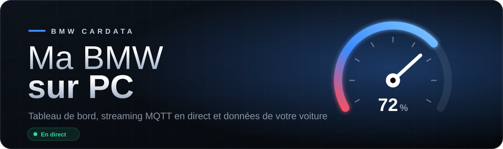
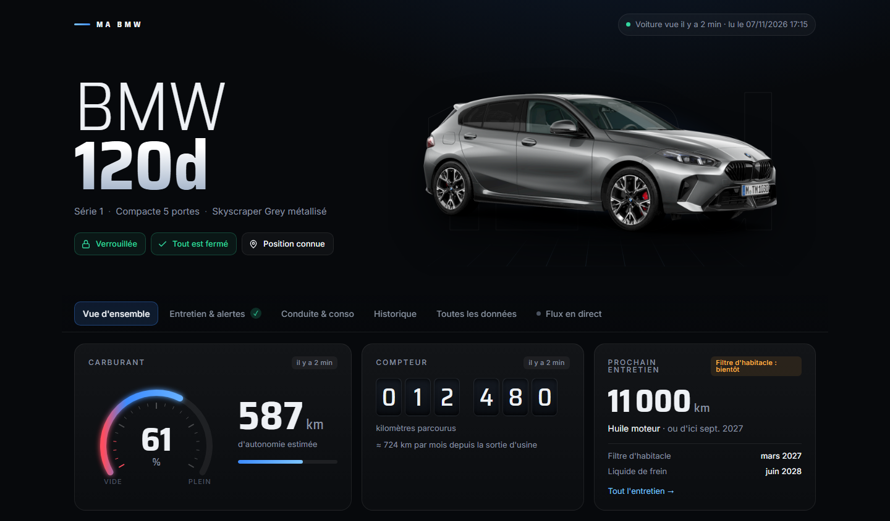
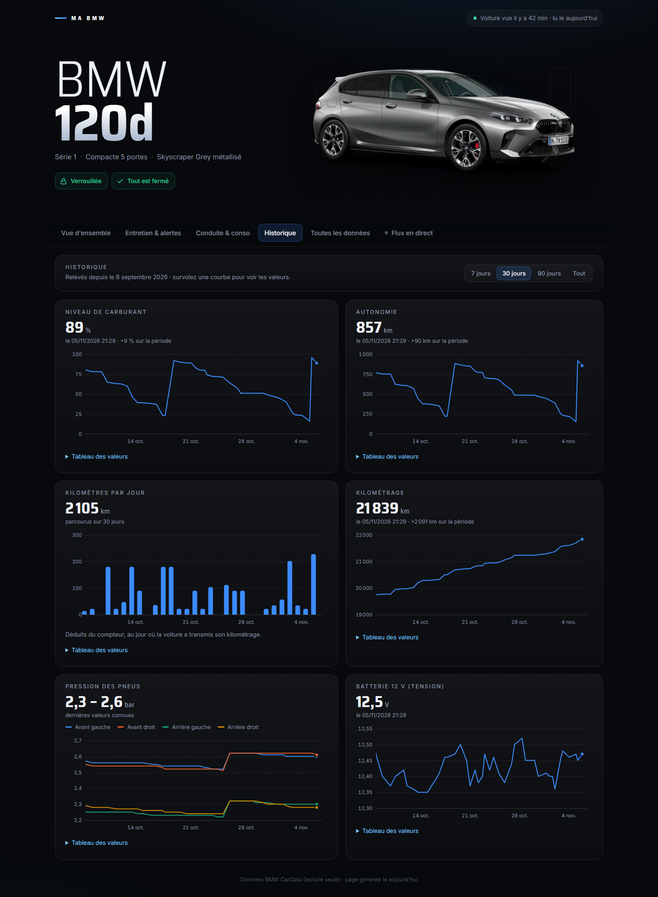
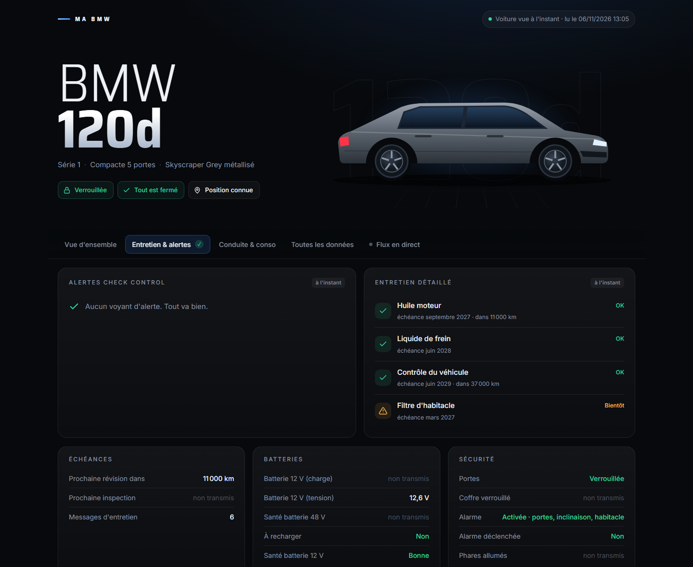
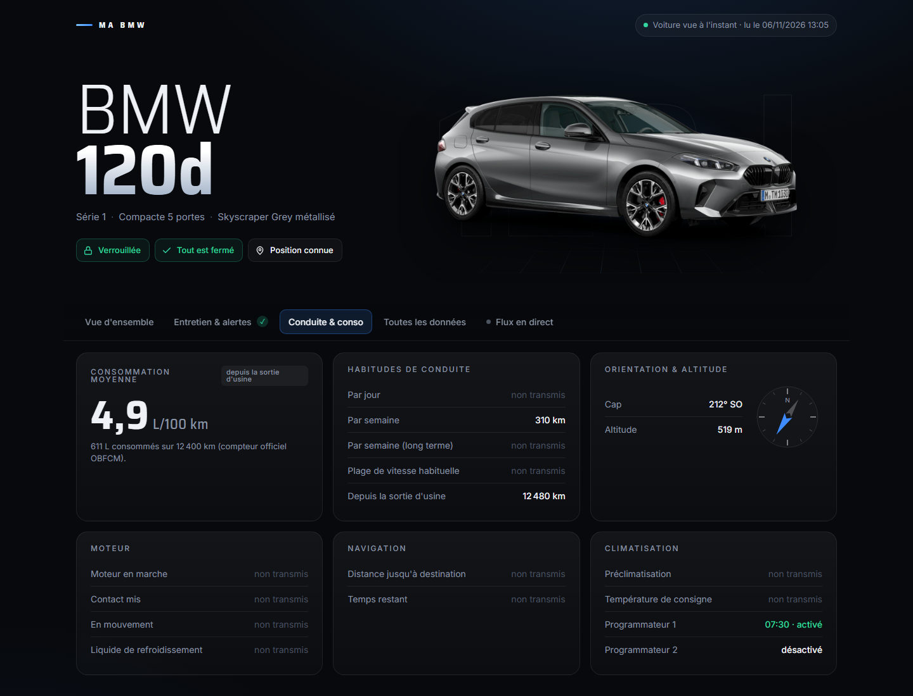
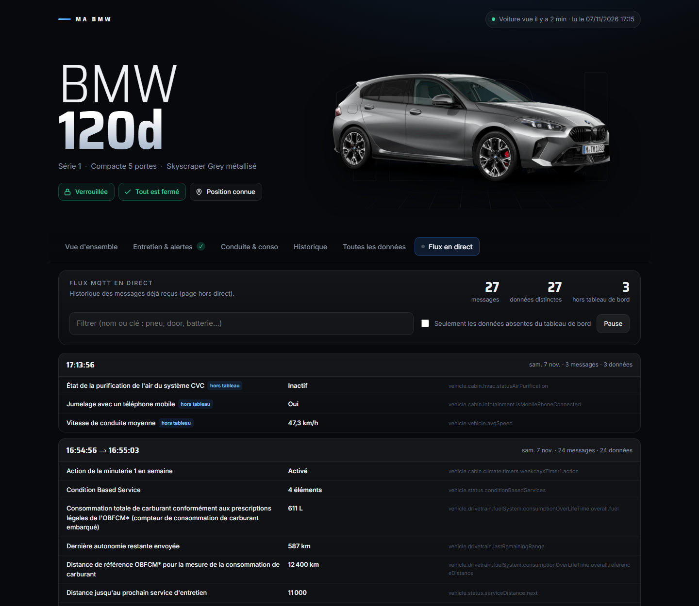
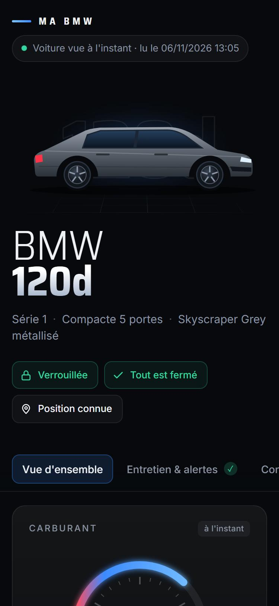
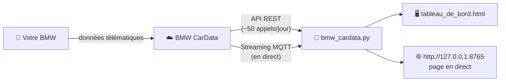

<a id="readme-top"></a>

<div align="center">



<br>

**Suivez votre BMW depuis votre PC : un tableau de bord élégant, les données officielles BMW CarData et le streaming en direct.**

<br>

[](https://www.python.org/downloads/)
[](https://www.bmw.fr/fr-fr/mybmw/public/cardata-telematic-catalogue)
[](#streaming)
[](LICENSE)

<br>

[Fonctionnalités](#fonctionnalites) •
[Captures](#captures) •
[Installation](#installation) •
[Utilisation](#utilisation) •
[Streaming](#streaming) •
[FAQ](#faq)

</div>

<br>

> [!IMPORTANT]
> **Lecture seule.** L'API officielle BMW CarData permet de **lire** les données de la voiture, pas de la commander. Pour klaxonner, faire clignoter les phares, verrouiller la voiture ou lancer la clim, il faut toujours passer par l'appli My BMW.

<br>

## 📑 Sommaire

- [✨ Fonctionnalités](#fonctionnalites)
- [📸 Captures d'écran](#captures)
- [🧭 Comment ça marche](#fonctionnement)
- [📦 Prérequis](#prerequis)
- [🚀 Installation](#installation)
  - [1. Activer BMW CarData sur votre compte](#activer-cardata)
  - [2. Récupérer le projet](#recuperer)
  - [3. Se connecter](#connexion)
- [🕹️ Utilisation](#utilisation)
- [📡 Streaming en direct](#streaming)
- [🖥️ Le tableau de bord](#tableau-de-bord)
- [📊 Données récupérées](#donnees)
- [🔒 Confidentialité](#confidentialite)
- [⚠️ Limites à connaître](#limites)
- [❓ FAQ et dépannage](#faq)
- [🗂️ Structure du projet](#structure)
- [📜 Licence et avertissement](#licence)

<br>

<a id="fonctionnalites"></a>
## ✨ Fonctionnalités

<table>
<tr>
<td width="50%" valign="top">

### 🔐 Connexion officielle
Authentification **OAuth Device Code + PKCE** avec votre compte BMW. Les jetons se renouvellent tout seuls : il suffit de se connecter une fois.

### 📊 72 données suivies
Kilométrage, carburant, autonomie, **consommation réelle**, ouvrants, pneus avec leur **pression de consigne**, entretien détaillé, alertes Check Control, batteries 12 V et 48 V, alarme, position…

### 📡 Streaming MQTT en direct
La voiture envoie ses données dès qu'elle les transmet. La page se met à jour toute seule, et la connexion se rétablit seule en cas de coupure.

</td>
<td width="50%" valign="top">

### 🖥️ Tableau de bord élégant
Thème sombre, jauge animée, compteur à rouleaux, vue de dessus de la voiture, carte, graphiques d'historique, six onglets. Fonctionne aussi sur téléphone.

### 🔎 Flux brut consultable
Un onglet affiche **chaque message MQTT reçu**, avec les noms officiels BMW en français, même pour les données que le tableau de bord n'affiche pas.

### 🪶 Léger et sans installation lourde
Un seul script Python, sans dépendance externe pour l'usage courant. Seul le streaming demande `paho-mqtt`.

</td>
</tr>
</table>

<br>

<a id="captures"></a>
## 📸 Captures d'écran

> Captures réalisées avec des **données fictives**. La photo est celle que l'API BMW CarData renvoie pour le véhicule (commande `profile`).

<div align="center">

**Vue d'ensemble**



<br><br>

**Historique**



<br><br>

<table>
<tr>
<td align="center" width="50%"><b>Entretien &amp; alertes</b><br><br></td>
<td align="center" width="50%"><b>Conduite &amp; conso</b><br><br></td>
</tr>
<tr>
<td align="center" width="50%"><b>Flux MQTT en direct</b><br><br></td>
<td align="center" width="50%"><b>Sur téléphone</b><br><br></td>
</tr>
</table>

</div>

<br>

<a id="fonctionnement"></a>
## 🧭 Comment ça marche



| Mode | Commande | Principe |
|---|---|---|
| **Lecture ponctuelle** | `status` | Votre PC interroge BMW, dans la limite d'environ 50 appels par jour. |
| **Direct** | `stream` | BMW envoie chaque nouvelle donnée dès que la voiture la transmet. |

<br>

<a id="prerequis"></a>
## 📦 Prérequis

- Une **BMW connectée** (ConnectedDrive) et un compte **My BMW**
- **Python 3.9 ou plus récent** : [python.org/downloads](https://www.python.org/downloads/)
- Pour le streaming uniquement : la bibliothèque `paho-mqtt` (version 2)

<br>

<a id="installation"></a>
## 🚀 Installation

<a id="activer-cardata"></a>
### 1. Activer BMW CarData sur votre compte

1. Connectez-vous à **My BMW sur le web** (site BMW de votre pays, rubrique « My BMW »), avec le même compte que l'appli.
2. Ouvrez votre véhicule, puis la section **BMW CarData**.
3. Cliquez sur **Create CarData Client** et copiez le **Client ID** affiché.
4. Activez le service **CarData API**.
5. *(Pour le direct)* Activez aussi **CarData Stream**, créez un flux et cochez les données à recevoir dans **Modifier la sélection de données**.

> [!TIP]
> Attendez quelques minutes après l'activation avant de lancer la première connexion.

<a id="recuperer"></a>
### 2. Récupérer le projet

```bash
git clone https://github.com/Teddy57600/bmw-cardata-dashboard.git
```

```bash
cd bmw-cardata-dashboard
```

Uniquement si vous voulez le streaming :

```bash
python -m pip install -r requirements.txt
```

<a id="connexion"></a>
### 3. Se connecter

```bash
python bmw_cardata.py login
```

1. Collez votre **Client ID** quand le script le demande.
2. Une page BMW s'ouvre : connectez-vous et saisissez le **code affiché dans le terminal**.
3. Le message « Connexion réussie » s'affiche. Le script indique aussi si le streaming est autorisé.

<br>

<a id="utilisation"></a>
## 🕹️ Utilisation

| Commande | Effet | Appels BMW |
|---|---|:---:|
| `python bmw_cardata.py login` | Connexion à votre compte BMW | — |
| `python bmw_cardata.py status --open` | Lit l'état de la voiture et ouvre le tableau de bord | 1 |
| `python bmw_cardata.py stream --open` | Reste à l'écoute en direct et ouvre la page en direct | 0 |
| `python bmw_cardata.py show` | Régénère le tableau de bord avec les dernières données | 0 |
| `python bmw_cardata.py profile` | Récupère le modèle et la photo de la voiture (une seule fois) | 2 |
| `python bmw_cardata.py reset` | Oublie le VIN et le conteneur mémorisés | — |

L'option `--open` ouvre le tableau de bord dans votre navigateur.

> [!NOTE]
> Au premier `status`, le script retrouve votre VIN et crée chez BMW un **conteneur**, c'est-à-dire la liste des données à recevoir. Si cette liste change dans le script, le conteneur est recréé automatiquement.

<br>

<a id="streaming"></a>
## 📡 Streaming en direct

```bash
python bmw_cardata.py stream --open
```

Le script se connecte au serveur MQTT de BMW et ouvre la page **http://127.0.0.1:8765**, qui se met à jour toute seule.

| Paramètre du portail BMW | D'où le script le tient |
|---|---|
| **Hôte** et **port** | Valeurs fixes : `customer.streaming-cardata.bmwgroup.com:9000` (TLS) |
| **Nom d'utilisateur** | Votre identifiant client (`gcid`), renvoyé par BMW à la connexion |
| **Sujet** | `gcid/VIN`, reconstruit automatiquement |
| **Mot de passe** | Le jeton `id_token`, valable 1 h et renouvelé automatiquement |

Ces paramètres s'affichent au démarrage, pour les comparer avec ceux du portail. Si BMW en change un, vous pouvez le forcer dans `config.json` (`stream_host`, `stream_port`, `stream_username`, `stream_topic`).

**Le voyant d'état** dans la page et dans l'icône de l'onglet :

| Voyant | Signification |
|:---:|---|
| 🟢 | Connecté au flux BMW |
| 🔴 | Connexion coupée (reconnexion en cours) ou script arrêté |

> [!TIP]
> Pour provoquer un envoi de données, verrouillez ou déverrouillez la voiture depuis l'appli My BMW. Chaque message reçu est aussi enregistré dans `historique_stream.jsonl`.

<br>

<a id="tableau-de-bord"></a>
## 🖥️ Le tableau de bord

| Onglet | Contenu |
|---|---|
| **Vue d'ensemble** | Photo officielle de la voiture (commande `profile`), jauge de carburant, compteur, prochain entretien, vue de dessus (portes, vitres, coffre, capot, toit ouvrant, pneus), carte, fiche technique |
| **Entretien & alertes** | Voyants Check Control, entretien détaillé (huile, liquide de frein…), échéances, batteries, alarme, mémoire des défauts |
| **Conduite & conso** | Consommation moyenne réelle (compteur officiel OBFCM), habitudes de conduite, cap et altitude, moteur, navigation, programmateurs de clim |
| **Historique** | Graphiques sur 7, 30 ou 90 jours : carburant, autonomie, kilomètres par jour, kilométrage, pression des pneus, batterie 12 V. Valeurs au survol, et tableau des valeurs sous chaque graphique |
| **Toutes les données** | La liste complète des valeurs connues, avec une recherche |
| **Flux en direct** | Chaque message MQTT reçu, regroupé par rafale, avec filtre, pause et repérage des données « hors tableau » |

Une valeur transmise il y a plus de **7 jours** est signalée comme ancienne donnée.

<br>

<a id="donnees"></a>
## 📊 Données récupérées

<details>
<summary><b>Voir les 72 données demandées à BMW</b></summary>

<br>

| Thème | Données |
|---|---|
| **Général** | Kilométrage, prochain entretien, inspection, messages et détail de l'entretien (CBS), alertes Check Control, mémoire des défauts |
| **Énergie** | Niveau et litres de carburant, autonomie, consommation totale et distance de référence (OBFCM), données électriques pour les hybrides rechargeables et électriques |
| **Batteries** | Charge et tension 12 V, santé 12 V et 48 V, besoin de recharge |
| **Ouvrants** | Verrouillage, 4 portes, 4 vitres, coffre, capot, toit ouvrant |
| **Sécurité** | État de l'alarme, déclenchement, phares |
| **Conduite** | Moteur, contact, mouvement, liquide de refroidissement, distances moyennes, plage de vitesse |
| **Pneus** | Pression mesurée, pression de consigne et température de chaque pneu |
| **Position** | Latitude, longitude, cap, altitude, destination de navigation |
| **Confort** | Préclimatisation, température de consigne, programmateurs |

La liste se modifie dans `DESCRIPTORS`, en haut de `bmw_cardata.py`. Le catalogue complet (294 données) est sur [bmw.fr](https://www.bmw.fr/fr-fr/mybmw/public/cardata-telematic-catalogue). Les données disponibles varient selon le modèle, la motorisation et les options.

</details>

<br>

<a id="confidentialite"></a>
## 🔒 Confidentialité

Tout reste **sur votre PC**. Le script ne parle qu'aux serveurs de BMW, et la page en direct n'est accessible que depuis votre machine (`127.0.0.1`). Le petit serveur local ne sert que la page et la photo, jamais vos jetons.

Les fichiers personnels sont exclus du dépôt par le [`.gitignore`](.gitignore) :

| Fichier | Contenu |
|---|---|
| `tokens.json` | Jetons de connexion BMW (**à ne jamais partager**) |
| `config.json` | Client ID, VIN, identifiant du conteneur |
| `derniere_lecture.json` | Dernières données connues, dont la position GPS |
| `historique_stream.jsonl` | Historique des messages reçus en direct |
| `historique_lectures.jsonl` | Valeurs suivies relevées à chaque `status` (pour les graphiques) |
| `profil_vehicule.json`, `voiture.png` | Fiche et photo du véhicule |
| `tableau_de_bord.html` | Page générée (contient le VIN et la position) |

<br>

<a id="limites"></a>
## ⚠️ Limites à connaître

- **Environ 50 appels API par jour et par compte.** Une lecture `status` en coûte 1. Pour suivre la voiture en continu, préférez `stream`.
- **Pas de temps réel absolu.** La voiture transmet ses données après un trajet, au verrouillage ou lors d'une action dans l'appli.
- **Une seule connexion de streaming à la fois** par compte : fermez les autres outils (Home Assistant…) avant de lancer `stream`.
- **Session de 14 jours.** Sans utilisation pendant 14 jours, il faut refaire `login`.
- **Lecture seule**, comme indiqué plus haut.

<br>

<a id="faq"></a>
## ❓ FAQ et dépannage

<details>
<summary><b>La page BMW me demande un « code » : lequel ?</b></summary>
<br>
C'est le code affiché dans le terminal par <code>python bmw_cardata.py login</code>, sur la ligne « saisissez ce code ». Il n'est valable que quelques minutes : relancez <code>login</code> s'il a expiré.
</details>

<details>
<summary><b>« Le streaming n'est pas autorisé pour votre connexion »</b></summary>
<br>
Activez <b>CarData Stream</b> sur le portail, créez un flux, puis refaites <code>python bmw_cardata.py login</code>. Le script doit alors afficher « Streaming : autorisé ».
</details>

<details>
<summary><b>Le flux est connecté mais rien n'arrive</b></summary>
<br>
C'est normal tant que la voiture ne transmet rien. Verrouillez ou déverrouillez-la depuis l'appli My BMW, et vérifiez que des données sont cochées dans la sélection du flux sur le portail.
</details>

<details>
<summary><b>« Limite quotidienne de l'API BMW atteinte »</b></summary>
<br>
Vous avez dépassé les ~50 appels du jour. Réessayez le lendemain. En attendant, <code>show</code> réaffiche les dernières données sans appel, et <code>stream</code> ne consomme pas d'appel.
</details>

<details>
<summary><b>Certaines valeurs affichent « non transmis »</b></summary>
<br>
La voiture ne les a pas encore envoyées, ou votre modèle ne les fournit pas (par exemple les données de recharge sur une voiture thermique).
</details>

<details>
<summary><b>« La session a expiré »</b></summary>
<br>
Les jetons n'ont pas été utilisés pendant plus de 14 jours. Refaites <code>python bmw_cardata.py login</code>.
</details>

<br>

<a id="structure"></a>
## 🗂️ Structure du projet

```text
bmw-cardata-dashboard/
├── bmw_cardata.py            # le script : connexion, API, streaming, génération de la page
├── dashboard_template.html   # modèle du tableau de bord (HTML, CSS et JavaScript)
├── catalogue_bmw.json        # noms officiels en français des 294 données BMW CarData
├── requirements.txt          # paho-mqtt (streaming uniquement)
├── docs/
│   ├── banniere.svg
│   └── captures/             # captures d'écran (données fictives)
├── LICENSE
└── README.md
```

<br>

<a id="licence"></a>
## 📜 Licence et avertissement

Projet distribué sous licence [MIT](LICENSE).

> [!CAUTION]
> Projet personnel **non officiel**, sans lien avec BMW AG ni affilié au BMW Group. « BMW », « My BMW », « ConnectedDrive » et « BMW CarData » sont des marques de BMW AG. Ce projet utilise uniquement l'interface officielle BMW CarData, mise à disposition des clients pour accéder aux données de leur propre véhicule.

<br>

<div align="center">

<sub>Fait avec ❤️ pour suivre sa BMW autrement · <a href="#readme-top">↑ Retour en haut</a></sub>

</div>
